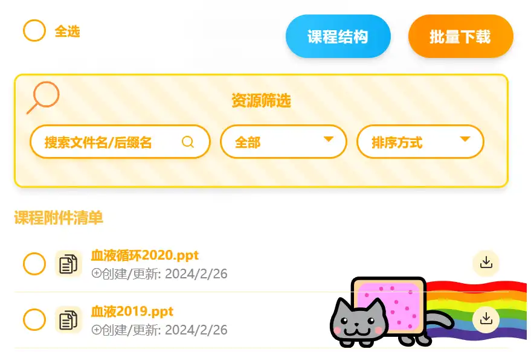
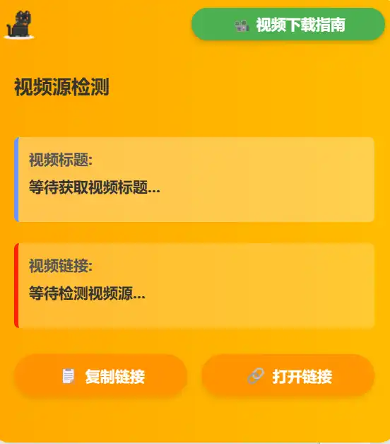

# 小雅爬爬爬 - 小雅平台课件下载工具 🚀

## 📌 项目简介

"小雅爬爬爬"是专为小雅平台设计的课件下载工具。它能自动抓取课程页面中的课件链接，提供直观的下载界面，实现高效的资源获取。

## 🔧 主要功能

- 🔍 自动抓取课件链接
- 🖥️ 统一工作台：课件 / 传输 / 工具 / 设置四个标签页
- 🎨 图标统一使用 Font Awesome 图标库
- 📦 批量下载、内嵌课程结构（搜索、展开/收起、全选与下载）
- 📤 支持导出链接（txt、ef2、json、csv、zip 格式）
- 📜 下载历史记录
- 🎥 视频资源抓取
- 🧰 隐藏资源按需探测（在下载列表点击「探测隐藏」后补全，本地缓存 12 小时）
- 🚄 支持第三方下载工具

## 🛠️ 使用方法

1. 📥 安装用户脚本管理器（推荐 [Tampermonkey](https://www.tampermonkey.net/)）
2. 💻 通过 [此链接](https://scriptcat.org/zh-CN/script-show-page/2771) 安装脚本
3. 🏫 访问小雅平台课程页面
4. 🖱️ 点击页面右下角的猫咪按钮，打开“小雅工作台”（也可以按 `Alt + X`）
5. ✅ 在“课件”页勾选所需文件并下载

详细使用说明：[小雅爬爬爬使用指南](https://xiaoya.zygame1314.site)

## ⚙️ 工作台说明

所有功能都收在一个抽屉里，不再需要在页面四角寻找按钮：

- **课件**：当前页课件、课程附件列表、全选、批量下载、课程结构（搜索、展开/收起、全选与下载）、导出
- **传输**：下载进度、下载方式切换、下载历史
- **工具**：使用提示、消息管理、视频源检测；隐藏资源在下载列表点击「探测隐藏」后补全
- **设置**：显示内容开关、自定义扩展名筛选、版本与更新

显示设置可以单独关闭“当前页课件卡片”“课程附件与导出”“下载进度”“视频源检测”，其余模块保持可用。

## 📸 功能预览

查看截图（旧版界面，仅作参考；以实际界面为准）

### 旧版：右上角下载按钮

### 旧版：右下角下载列表

### 旧版：右侧视频组件

### 旧版：控制面板

### 旧版：进度条

## ⚠️ 注意事项

- 用户搜索功能仅供学习和研究使用，禁止用于非法用途
- 下载历史记录保存期限为三天
- 使用第三方下载工具可能导致链接被拦截，请根据实际情况调整配置

## 🤝 贡献指南

欢迎参与项目改进：

- 发现 bug 请在 [Issues 页面](https://github.com/zygame1314/XiaoyaDownloader/issues) 提交报告
- 代码贡献请 fork 仓库，在新分支上开发后提交 Pull Request

## 📄 许可证

本项目采用 [MIT](LICENSE) 许可证

---

感谢使用 "小雅爬爬爬"。如有任何问题或建议，请随时与我联系。
